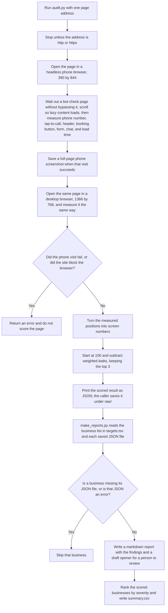

# lead-leak-audit

**A 60-second, read-only mobile audit that scores how many calls and bookings a local business's landing page is leaking, and turns it into a client-ready report plus a drafted (never sent) outreach opener.**

## How it works

`audit.py` opens one public page in a phone-sized browser and again on a desktop, measures how far a visitor has to scroll to call or book, and scores the leaks from 100. `make_reports.py` writes a markdown report, a severity ranking, and a draft opener. A person reviews that opener before anything is sent.




The same drawing is saved as [docs/diagram.svg](docs/diagram.svg) and [docs/diagram.mmd](docs/diagram.mmd).

## The problem
Local service businesses spend on ads, then send mobile visitors to pages where the phone number is three screens down, can't be tapped, and the quote form asks for eight fields. Owners don't see it because they browse on desktop. A GTM motion needs a concrete, specific reason to start the conversation, not "want more leads?".

## What it does
- **`audit.py`** – loads the page in headless Chromium as an iPhone (390×844) and as desktop, scrolls to trigger lazy content, and measures in-page:
  - which screen the first phone number and the first `tel:` link appear on, and whether the phone is in the header
  - first Book/Quote CTA or form, number of form fields
  - chat/text widget and scheduler signatures (~30 vendors)
  - load time, page length; full-page mobile screenshot
  - waits out bot-check interstitials but never bypasses them (blocked pages are reported, not scored)
  - **Read-only:** never clicks, submits, or calls.
- **Scoring** – starts at 100 and subtracts weighted, plain-English "leaks"; keeps the top 3.
- **`make_reports.py`** – one markdown report per business, a ranked `summary.csv` by severity, and a personalized **draft** opener citing the biggest leak.
- **`METHOD.md`** – the companion market-teardown method (10 businesses → top 3 prospects with a sourced gap and pitch).

## Run it
```bash
pip install -r requirements.txt && playwright install chromium
python3 audit.py https://example.com --name example --out work > work/raw/example.json   # mkdir -p work/raw first
python3 make_reports.py --dir work --region "Exampleville" --date 2026-01-15
```
Try it offline on the included fictional site:
```bash
(cd examples/site && python3 -m http.server 8765 &)
python3 audit.py http://127.0.0.1:8765/ --name sample-comfort --out examples > examples/raw/sample-comfort.json
python3 make_reports.py --dir examples --region Exampleville --date 2026-01-15
```

## Example output
`examples/reports/sample-comfort.md` (fictional "Sample Comfort HVAC"):

| Check | Result |
|---|---|
| First visible phone number | screen 3 |
| First tap-to-call (tel:) link | none found |
| Phone in header | no |
| First booking/quote button or form | screen 3 ("Request service") |
| Form on page | yes, 8 fields |
| Chat/text widget | none detected |

**Score: 38/100.** Top leaks: number not visible until screen 3; number can't be tapped to call; first form on screen 3.

> **Opener (DRAFT, not sent):** Hi, I ran a quick mobile check on your hvac page and noticed one thing that's likely costing you calls: on a phone, the number doesn't show up until screen 3...

## Use responsibly
Audit only public pages, respect robots and bot protection, and have a human review every opener before anything is sent.

`audit.py` only accepts `http://` and `https://` URLs (no `file://` or other schemes). It drives a real browser, so do not expose it as a web service that takes URLs from untrusted users without also blocking private/internal addresses.

## License
MIT
